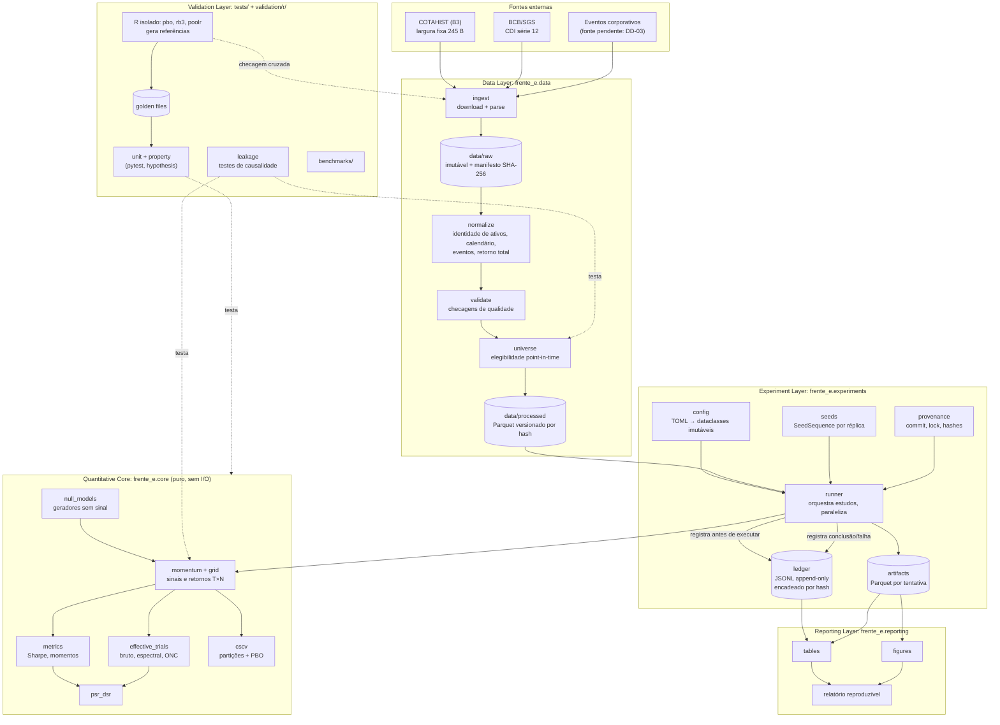

# Arquitetura — Frente E

Arquitetura inicial proposta. Data: 2026-11-06.
**Status: proposta aguardando aprovação do desenvolvedor.** Decisões individuais e alternativas em [ARCHITECTURE_DECISIONS.md](ARCHITECTURE_DECISIONS.md); justificativa da stack em [STACK_EVALUATION.md](STACK_EVALUATION.md).

## 1. Visão geral

**Monólito modular em Python**: um único pacote instalável, organizado em camadas, executado numa única máquina por uma CLI. R aparece apenas num ambiente isolado de validação, que produz arquivos de referência. Não há serviços, filas nem banco de dados servidor.

Três princípios estruturais:
1. **O núcleo quantitativo é puro.** Recebe arrays NumPy e objetos de configuração imutáveis; devolve arrays e números. Não lê arquivos, não grava ledger, não plota. É a parte que precisa ser provada correta, e isolá-la torna isso possível.
2. **Dados brutos são imutáveis; tudo o mais é derivado e endereçado por hash.** Qualquer resultado é reconstruível a partir de (manifesto dos brutos, commit do código, configuração, semente).
3. **Nenhuma tentativa roda fora do ledger.** O orquestrador registra a tentativa *antes* de executá-la; o núcleo não tem como ser chamado "por fora" no fluxo de estudos.

## 2. Diagrama



## 3. Responsabilidades por camada

### 3.1 Data Layer (`frente_e.data`)
| Módulo | Responsabilidade | Entrada → saída | Dependências pendentes |
|---|---|---|---|
| `ingest.cotahist` | Baixar arquivos anuais e parsear o layout de largura fixa | ZIP/TXT da B3 → Parquet bruto tipado (todas as colunas do layout) | Layout oficial [E]; anos de início |
| `ingest.sgs` | Obter CDI diário (série 12) | API SGS → Parquet bruto + JSON original | DA-14 (cliente) |
| `ingest.corporate_actions` | Obter eventos (desdobramentos, grupamentos, bonificações, proventos) | Fonte a definir → tabela de eventos | **DD-03** |
| `manifest` | Registrar SHA-256, data de download, URL e tamanho de cada bruto | Arquivos → `data/manifests/*.json` (versionado) | — |
| `normalize` | Identidade de ativos (ISIN × ticker ao longo do tempo), calendário de pregões a partir dos próprios dados, **retornos totais diários** calculados a partir de preço bruto + eventos | Brutos → painel de retornos | DD-03, DD-04 |
| `validate` | Checagens explícitas: duplicatas, preços ≤ 0, saltos não explicados por eventos, lacunas, códigos de mercado/BDI inesperados | Painel → relatório de qualidade + falha se crítico | Critérios a fixar na etapa 2 do roadmap |
| `universe` | Tabela `eligibility(date, asset_id, métricas de liquidez, eligible, rule_version)` | Painel → elegibilidade por data | **DD-01** |

Regras da camada:
- Nunca sobrescrever brutos; derivados são regeneráveis.
- Falha de qualidade crítica **interrompe** o pipeline; nada de preenchimento silencioso.
- Retornos ajustados são calculados de forma *forward* (evento aplicado na data em que ocorre), o que evita look-ahead na série de retornos [R]. A escolha metodológica final é de DD-03.

### 3.2 Quantitative Core (`frente_e.core`)
| Módulo | Responsabilidade | Observação |
|---|---|---|
| `momentum` | Sinal de formação, construção da carteira e manutenção (com sobreposição de coortes, se adotada) | Definição em **DE-01**; sinal em t usa apenas dados ≤ t |
| `grid` | Expandir a especificação da grade em configurações canônicas com ID estável (hash) | O tamanho da grade é variável de pesquisa |
| `metrics` | Média, desvio, Sharpe, assimetria, **curtose bruta** | Convenções em DE-02 |
| `psr_dsr` | PSR(SR*), SR₀ esperado sob N tentativas, DSR | Fórmulas a confirmar no original (DE-02, DE-04) |
| `effective_trials` | Estratégias intercambiáveis: N bruto, espectrais (Nyholt, Li e Ji, Galwey), ONC | **DE-03**; interface comum `estimate(returns_TxN) -> NEffResult` |
| `cscv` | Gerar partições; calcular desempenho IS/OOS; λ, PBO, degradação | Esquema de partição como componente substituível, para permitir embargo/purga (**DE-06**) sem reestruturar |
| `null_models` | Geradores de dados sem sinal (em preços ou em retornos) | **DE-07** |

Interfaces (contratos):
- Entradas: `numpy.ndarray` float64 com dimensão explícita (T × N, A × T) e vetores de datas separados; configurações como `dataclass(frozen=True)`.
- Aleatoriedade: toda função estocástica recebe um `numpy.random.Generator`; nenhuma usa estado global.
- Saídas: dataclasses de resultado com os valores intermediários relevantes (ex.: PBO devolve λ de cada partição, não só a proporção).

### 3.3 Experiment Layer (`frente_e.experiments`)
| Módulo | Responsabilidade |
|---|---|
| `config` | Ler TOML (`tomllib`, stdlib), validar, produzir configuração canônica e seu hash |
| `provenance` | Capturar commit Git, estado *dirty*, hash do lockfile, versão do Python, plataforma, hash do manifesto de dados |
| `seeds` | Derivar fluxos aleatórios por réplica e tarefa via `SeedSequence.spawn`, de modo que o resultado não dependa do nº de processos |
| `ledger` | Escrever eventos append-only (único escritor: o processo orquestrador); verificar a cadeia de hashes; ler para análise |
| `runner` | Executar um *estudo*: registrar tentativas, despachar trabalho a processos, coletar resultados, gravar artefatos e eventos de conclusão/falha |

**Modelo do ledger (implementado, schema v1; contrato completo em ARCHITECTURE_DECISIONS.md, DA-03):**
- `experiment_id` identifica o estudo lógico, `run_id` uma execução e `configuration_fingerprint` a configuração científica (parâmetros, universo, pré-registro e sementes).
- Cada execução gera um registro `started` (configuração completa, ambiente, revisão do código, entradas) e um terminal: `completed` (referências de artefatos), `failed` (erro) ou `aborted` (interrupção).
- Cada linha carrega o hash da anterior, e a âncora externa `N:SHA256` cobre o que a cadeia sozinha não detecta (reescrita total, remoção das últimas linhas).
- O ledger (texto) é versionado no Git; resultados volumosos ficam num armazém local endereçado por conteúdo, fora do Git.
- *Mudança em relação ao desenho conceitual anterior:* os eventos `study_*`/`trial_*` foram substituídos por um registro por execução. Uma "tentativa" no sentido do DSR é derivável do ledger (por fingerprint ou por configuração da estratégia), conforme a definição que DE-04 adotar.

Módulos: `canonical` (serialização), `identity` (IDs e fingerprint), `records` (schema), `ledger` (escrita, verificação, recuperação), `artifacts`, `provenance`, `seeds`. Comandos: `frente-e ledger verify | head | incomplete | recover-tail | abort`.

Execução paralela: `concurrent.futures.ProcessPoolExecutor` (stdlib). Os *workers* calculam e devolvem resultados; só o orquestrador escreve no ledger, o que elimina a concorrência de escrita.

### 3.4 Validation Layer (`tests/`, `validation/r/`, `benchmarks/`)
| Tipo | Conteúdo |
|---|---|
| Unitários | Cada função do núcleo com casos calculados à mão |
| Propriedade (hypothesis) | Invariantes: PSR monotônico em ŜR e T; SR₀ crescente em N; partições CSCV disjuntas e complementares, em número C(S,S/2); N efetivo = N para séries independentes e → 1 para séries idênticas |
| Resposta conhecida | Dados sintéticos com sinal plantado (PBO → 0) e sem sinal (PBO ≈ 0,5 em média) |
| Referência | *Golden files* gerados por `validation/r/` (`pbo`, `poolr::meff`, `rb3`), comparados com tolerância declarada |
| Vazamento | Perturbar dados após t e verificar que sinais, universo e retornos até t não mudam |
| Integração | Pipeline completo em amostra pequena e fixa, com resultado conhecido |
| Desempenho | Scripts de `benchmarks/` (B1–B6), fora da suíte padrão |

O ambiente R é executado só para (re)gerar referências; a suíte do dia a dia roda apenas em Python.

### 3.5 Reporting Layer (`frente_e.reporting`)
- Lê apenas o ledger e os artefatos; nunca recalcula métricas por conta própria (evita divergência entre o relatório e o que foi registrado).
- Saídas: tabelas (Sharpe bruto, PSR, DSR de **toda** a grade; PBO; sensibilidade do DSR a N), figuras (distribuição de λ, IS vs. OOS, matriz de correlação entre estratégias, DSR × N efetivo) e exportação CSV/Parquet.
- Notebooks servem à exploração e **não são fonte de verdade**; o relatório final é gerado por código versionado (DA-13).

## 4. Fluxos principais

1. **Preparação de dados:** `ingest` → manifesto → `normalize` → `validate` → `universe` → `data/processed/<hash>/`.
2. **Estudo real:** configuração do estudo (pré-registrada e commitada) → `runner` registra estudo e tentativas → núcleo calcula T × N → métricas, N efetivo, DSR, CSCV/PBO → artefatos + eventos de conclusão.
3. **Simulação sob a nula:** `null_models` gera R conjuntos de dados (sementes derivadas) → para cada um, o mesmo procedimento do fluxo 2 → taxa de "descobertas" vs. nível nominal. Registrada no ledger como estudo do tipo `simulation`, **separado** dos estudos com dados reais (não entra no N das estratégias reais).
4. **Validação de referência:** matriz fixa → R gera golden → Python compara.
5. **Relatório:** ledger + artefatos → tabelas/figuras → documento.

## 5. Organização física proposta

```
quant development/
├── pyproject.toml            # pacote + dependências (gerenciado por uv, DA-11)
├── uv.lock                   # lockfile (versionado)
├── src/frente_e/
│   ├── data/                 # ingest/, manifest.py, normalize.py, validate.py, universe.py
│   ├── core/                 # momentum.py, grid.py, metrics.py, psr_dsr.py,
│   │                         # effective_trials.py, cscv.py, null_models.py
│   ├── experiments/          # config.py, provenance.py, seeds.py, ledger.py, runner.py
│   ├── reporting/            # tables.py, figures.py
│   └── cli.py                # ponto de entrada único (python -m frente_e ...)
├── configs/
│   ├── data/                 # parâmetros de ingestão e universo (TOML)
│   └── studies/              # estudos pré-registrados (TOML, versionados)
├── data/
│   ├── raw/                  # brutos imutáveis (fora do Git)
│   ├── processed/            # derivados por hash (fora do Git)
│   └── manifests/            # hashes e proveniência (versionado)
├── experiments/
│   ├── ledger.jsonl          # registro científico (versionado)
│   └── artifacts/            # séries por tentativa (fora do Git)
├── tests/                    # unit/, property/, reference/, leakage/, integration/, fixtures/golden/
├── validation/r/             # scripts R + renv.lock (ambiente isolado)
├── benchmarks/
├── notebooks/                # exploração, não fonte de verdade
├── reports/                  # saídas geradas
└── docs/
```

Regras de `.gitignore` para `data/raw/`, `data/processed/`, `experiments/artifacts/` e a biblioteca local do `renv` serão adicionadas na etapa 1 do roadmap, quando a estrutura for criada.

## 6. Evolução sem reestruturação

| Gatilho (medido) | Evolução | O que não muda |
|---|---|---|
| B2/B3/B5 acima do orçamento (DA-07) | Numba nos kernels identificados | Interfaces do núcleo |
| Numba insuficiente (B6) | Kernel nativo (Rust/PyO3) ou Julia para o ponto quente | Restante da arquitetura |
| Necessidade de UI de comparação ou de colaboradores | Exportar o ledger para MLflow (o ledger continua sendo a fonte de verdade) | Ledger |
| Múltiplas máquinas ou armazenamento remoto | DVC ou equivalente sobre `data/raw` | Manifestos e hashes |
| Novas famílias (value, size) | Novos módulos em `core/` e novas fontes em `data/ingest/` | Ledger, CSCV, DSR |
| CPCV / walk-forward | Novos esquemas de partição na interface de `cscv` | Restante do núcleo |
