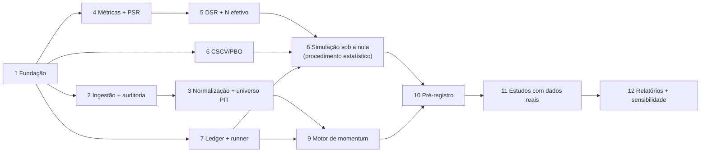

# Roadmap de implementação — Frente E

Sequência de desenvolvimento derivada de [ARCHITECTURE.md](ARCHITECTURE.md). Data: 2026-11-06. Sem prazos.
**Pré-condição global:** a arquitetura (DA-01 a DA-14) aprovada pelo desenvolvedor.

## Estado da implementação (atualizado em 2026-11-06)

Categorias usadas abaixo, que **não são equivalentes**: implementado · testado · validado matematicamente · validado por referência independente · pendente de decisão · pendente de dados.

| Etapa | Estado |
|---|---|
| 1. Fundação | **Implementada e testada.** Esqueleto em camadas, uv + Python 3.13.5, `configs/project.toml` com validação estrita, hierarquia de erros (incluindo `PendingDecisionError`), logging UTC, detecção de recursos e planejamento de processos dentro do orçamento, contrato `ReturnsMatrix`, testes de arquitetura (o núcleo não faz I/O nem usa RNG global), CLI `info`. |
| 7. Ledger e reprodutibilidade (Etapa 2 do pedido de implementação) | **Implementada e testada.** Serialização canônica, fingerprint, IDs, JSONL append-only encadeado por SHA-256, verificador, âncora externa, escritor único com trava do SO, recuperação de cauda truncada, registro de falhas e interrupções, armazém de artefatos, proveniência (Git e ambiente), sementes por `SeedSequence`, CLI `ledger`. Teste de ponta a ponta: execução sintética reconstruída a partir do ledger com resultado idêntico bit a bit. DA-03 aguarda aprovação formal. |
| Ambiente R de validação | **Pronto.** R 4.6.2 + renv (`pbo`, `poolr`). Golden files gerados e congelados: 3 casos de PBO, 2 de N efetivo. *Integridade testada*; nenhuma implementação própria comparada ainda. |
| 4–5. Métricas, PSR, DSR, MinTRL e candidatos a N efetivo | **Implementados e testados (2026-11-06); DE-02, DE-02.a, DE-03.a, DE-04.c e DE-08 DECIDED.** `core.sharpe_inference` (PSR, DSR, MinTRL: 7 âncoras publicadas reproduzidas), `core.effective_trials` (6 candidatos; `floor` confere com `poolr`), `core.null_models` e o estudo `experiments.neff_study` (simulação preliminar registrada no ledger). O estimador principal de N efetivo continua **aberto** (DE-03), e V é provisório (DE-04.b). Abaixo, o estado anterior, preservado: **Implementado e testado, convenção pendente de confirmação (DE-02):** retorno excedente, Sharpe diário (ddof=1), anualização √252, assimetria g₁ e curtose de Pearson b₂, e CDI por intervalo (`core.rates`). Momentos *validados por referência independente* (SciPy) e por propriedades matemáticas. **PSR/DSR não implementados.** |
| 2–3, 5–6, 8–12 | Não iniciadas. |

Testes: 210 passando (unitários ≈ 19 s; suíte completa 30–60 s nesta máquina); ruff e mypy estrito limpos.

**Validação do DSR (DE-08, DECIDED em 2026-11-06):** o DSR do projeto está implementado e reproduz as âncoras A1–A3; PSR e MinTRL reproduzem A4–A7 (`tests/reference/test_published_anchors.py`). Falta a calibração por simulação (METHODOLOGY_CONVENTIONS.md §1.9, item 5; DE-07). Histórico: antes desta data, a referência estava só identificada e o DSR não estava implementado.

### Classificação de DA-01 a DA-14 para a implementação inicial
| ID | Classificação | Motivo |
|---|---|---|
| DA-01 | Não bloqueante | Esqueleto criado conforme a proposta; reversível. |
| DA-02 | Não bloqueante | R instalado com autorização (2026-11-06); golden files gerados. |
| DA-03 | Implementada; aguarda aprovação formal | Formato adotado pelo desenvolvedor como proposta principal; o ledger do projeto ainda não tem registros, então ajustes são baratos até o primeiro estudo. |
| DA-04 | Não bloqueante | Manifestos entram com a ingestão. |
| DA-05 | Não bloqueante | Polars entra com a camada de dados. |
| DA-06 | Não bloqueante | pytest + hypothesis já em uso. |
| DA-07 | Não bloqueante | Orçamento provisório recebido; paralelismo só após medição. |
| DA-08 | Decidida | — |
| DA-09 | Não bloqueante (parser) / requer R (checagem com `rb3`) | — |
| DA-10 | **Bloqueante** para normalização (Etapa 3) | A fonte de eventos corporativos (DD-03) não está definida. |
| DA-11 | Não bloqueante | uv + Python 3.13.5; renv em `validation/r/`. |
| DA-12 | Não bloqueante | — |
| DA-13 | Não bloqueante | Necessária só na Etapa 12. |
| DA-14 | Não bloqueante | Verificar o cliente do SGS na ingestão. |

Decisões **estatísticas** que bloqueiam a próxima fase do núcleo (estado em 2026-11-06, 2ª sessão):
- **resolvidas:** DE-02, DE-02.a, DE-08, DE-03.a, DE-04.a, DE-04.c e as convenções de DE-05;
- **ainda bloqueiam a CSCV/PBO:** o golden com N ímpar (DE-05.a);
- **ainda bloqueiam o estudo real:**
  - o valor de S, porque depende de DE-01 e DD-01;
  - o estimador principal de N e V (DE-03, DE-04.b), porque depende das estruturas da grade (DE-01) e de um desenho não nulo (DE-07);
  - o critério de taxa nominal (DE-07), porque o DSR com limiar 0,95 não é um teste de nível 5%;
  - DD-05.

Histórico, como estava antes: DE-02 (convenções do Sharpe/PSR, proposta formal em METHODOLOGY_CONVENTIONS.md §1), DE-08 (referência do DSR: identificada, falta confirmação visual), DE-03 (N efetivo; inclui arredondar ou não), DE-04 (V e escopo de N), DE-05 (métrica, S, ω̄ = rank/N ou rank/(N+1), T não divisível por S), DD-05 (política de ausências, proposta em §2).

## Por que a ordem difere da sugestão inicial

A sugestão original colocava dados antes da estatística e o registro de experimentos no passo 8. Foram feitas três mudanças, todas por dependência metodológica:

1. **O núcleo estatístico (PSR, DSR, N efetivo, CSCV/PBO) é desenvolvido e validado só com dados sintéticos**, sem esperar os dados da B3. Ele não depende deles e pode revelar cedo se o procedimento funciona (simulação sob a nula).
2. **O ledger vem antes de qualquer tentativa com dados reais.** Se ele vier depois, tentativas exploratórias ficam sem registro e o N fica subestimado, que é o erro estudado.
3. **Há um passo explícito de pré-registro** (grade, universo, limiares) antes do primeiro estudo com dados reais, conforme a regra "fixar antes de ver resultados".

Os passos 2 e 3 (trilha de dados) podem correr em paralelo aos passos 4 a 8 (trilha estatística).

---

## Etapa 1 — Fundação do repositório e do ambiente
- **Objetivo:** Estrutura física (ARCHITECTURE §5), ambiente reproduzível, ferramental de qualidade.
- **Componentes:** `git init` (decisão do desenvolvedor), `pyproject.toml`, `uv.lock`, esqueleto de `src/frente_e/`, configuração de ruff, mypy e pytest; `.gitignore` estendido (`data/raw/`, `data/processed/`, `experiments/artifacts/`, biblioteca do `renv`); ambiente R isolado em `validation/r/`.
- **Dependências:** aprovação de DA-01, DA-02, DA-11.
- **Conclusão quando:** o ambiente é recriado do zero a partir do lockfile; a suíte vazia roda; `CLAUDE.md` continua ignorado e os demais arquivos versionáveis.
- **Testes:** teste trivial de importação; verificação do `.gitignore` com `git check-ignore`.
- **Riscos:** versões de dependências no Windows; R e `renv` no Windows.

## Etapa 2 — Ingestão e auditoria dos dados
- **Objetivo:** Brutos imutáveis com manifesto; responder às perguntas da auditoria do COTAHIST (DD-02).
- **Componentes:** `data.ingest.cotahist`, `data.ingest.sgs`, `data.manifest`; benchmark B1; checagem cruzada com `rb3`.
- **Dependências:** Etapa 1; layout oficial (confirmar revisão vigente); DA-09, DA-14.
- **Conclusão quando:** parser reproduz contagens e preços do `rb3` nos anos amostrados; manifesto com hashes; **relatório de auditoria** respondendo: há ativos deslistados? Desde quando há ISIN? Como se comportam os códigos BDI e de mercado ao longo do tempo? Há mudanças de moeda ou fator de cotação?
- **Testes:** parser contra registros construídos à mão a partir do layout; header/trailer; idempotência (reingestão gera os mesmos hashes).
- **Riscos:** viés de sobrevivência não resolvível só com COTAHIST; arquivos da B3 alterados ao longo do tempo; limites da API SGS.

## Etapa 3 — Normalização, eventos corporativos e universo point-in-time
- **Objetivo:** Painel de retornos totais diários, CDI alinhado e tabela de elegibilidade por data.
- **Componentes:** `data.normalize`, `data.validate`, `data.universe`, `ingest.corporate_actions`.
- **Dependências:** Etapa 2; **DD-01, DD-03, DD-04 decididos** (bloqueante).
- **Conclusão quando:** retornos totais conferidos contra casos conhecidos (eventos documentados de alguns papéis); relatório de qualidade sem falhas críticas; elegibilidade reconstruível para qualquer data.
- **Testes:** causalidade (alterar dados após t não altera retornos nem elegibilidade até t); saltos de preço sem evento correspondente são sinalizados; desdobramento sintético gera retorno zero.
- **Riscos:** fonte de eventos incompleta (o maior risco de dados do projeto); identidade de ativos com troca de ticker.

## Etapa 4 — Métricas e PSR
- **Objetivo:** Sharpe, momentos e PSR validados.
- **Componentes:** `core.metrics` e `core.sharpe_inference`. O nome previsto era `core.psr_dsr`; foi mudado porque o módulo também contém o MinTRL e o fator de máximo esperado.
- **Dependências:** Etapa 1; **DE-02** (convenções; conferir a fórmula no artigo original).
- **Conclusão quando:** todos os testes de propriedade e de casos à mão passam; a convenção de curtose (bruta) está testada explicitamente.
- **Testes:** normalidade → forma reduzida; monotonia em ŜR e T; comparação com valores calculados independentemente; estabilidade numérica nas caudas (`logcdf`).
- **Riscos:** confusão curtose/excesso; escala (diária vs. anual).

## Etapa 5 — DSR e número efetivo de tentativas
- **Objetivo:** SR₀ esperado, DSR e estimadores de N efetivo intercambiáveis.
- **Componentes:** `core.psr_dsr`, `core.effective_trials`; benchmark B4; golden files de `poolr::meff`.
- **Dependências:** Etapa 4; **DE-03, DE-04, DE-08**.
- **Conclusão quando:** DSR confere com a referência definida em DE-08; estimadores espectrais conferem com `poolr`; ONC (se adotado) é estável entre sementes dentro de tolerância declarada.
- **Testes:** séries independentes → N efetivo ≈ N; séries idênticas → 1; blocos de correlação conhecidos → nº de blocos; SR₀ crescente em N e V.
- **Riscos:** ausência de referência para DSR; custo do ONC.

## Etapa 6 — CSCV e PBO
- **Objetivo:** Partições, λ, PBO, degradação; esquema de partição substituível.
- **Componentes:** `core.cscv`; benchmark B3; golden files do `pbo` (R).
- **Dependências:** Etapa 1; **DE-05**; interface preparada para DE-06.
- **Conclusão quando:** PBO idêntica (ou dentro da tolerância declarada) à do `pbo` em matrizes de teste, incluindo casos com empates e T não divisível por S.
- **Testes:** número de partições C(S,S/2); IS ∩ OOS = ∅; sinal plantado → PBO ≈ 0; ruído puro → PBO ≈ 0,5 em média.
- **Riscos:** diferenças de convenção com o pacote R (truncamento, ranking).

## Etapa 7 — Ledger e orquestração de experimentos
- **Objetivo:** Nenhuma tentativa fora do registro.
- **Componentes:** `experiments.config`, `provenance`, `seeds`, `ledger`, `runner`, `cli`.
- **Dependências:** Etapa 1; DA-03, DA-04, DA-07.
- **Conclusão quando:** um estudo fictício (sintético) é registrado, executado em paralelo e reconstruído a partir do ledger; a cadeia de hashes detecta adulteração; execução com código *dirty* é bloqueada para estudos reais.
- **Testes:** resultado bit a bit igual com 1 e k processos; falha de uma tentativa gera `trial_failed` e não interrompe o registro; verificação da cadeia.
- **Riscos:** proveniência incompleta (ex.: esquecer o hash do lockfile).

## Etapa 8 — Simulação sob a nula (validação do procedimento)
- **Objetivo:** Medir a taxa de falsa descoberta do procedimento completo em dados sem sinal (critério de sucesso 2).
- **Componentes:** `core.null_models`, `runner`; benchmark B5.
- **Dependências:** Etapas 5, 6, 7; **DE-07** (gerador, α, nº de réplicas, tolerância fixada antes de rodar); DA-07 (orçamento).
- **Conclusão quando:** a taxa observada e seu intervalo de Monte Carlo estão registrados e comparados com o nível nominal segundo o critério pré-fixado. Um resultado fora da tolerância é um **achado**, não um bug a ser "ajustado": investigar e documentar.
- **Testes:** reprodutibilidade por semente; sanidade em casos-limite (N=1).
- **Riscos:** custo computacional (gatilho para Numba); a primeira versão usa gerador simples (sem caudas pesadas, que estão fora do escopo).

## Etapa 9 — Motor de momentum
- **Objetivo:** Retornos T × N da grade, sem look-ahead.
- **Componentes:** `core.momentum`, `core.grid`; benchmark B2.
- **Dependências:** Etapa 3 (para dados reais; desenvolvimento pode usar preços sintéticos); Etapa 7; **DE-01, DE-06**.
- **Conclusão quando:** resultados conferem com implementação ingênua (laço explícito) em amostras pequenas; testes de causalidade passam.
- **Testes:** sinal em t usa só dados ≤ t; sobreposição de coortes conferida à mão; preços com tendência sintética conhecida → sinal esperado.
- **Riscos:** convenções implícitas (timing, rebalanceamento, caixa) não documentadas.

## Etapa 10 — Pré-registro do estudo
- **Objetivo:** Fixar, antes de ver resultados reais, grade(s), universo e filtro de liquidez, período, S, método de N efetivo, limiares (DE-09) e definição de "tentativa" para N (DE-04).
- **Componentes:** `configs/studies/*.toml` commitados; entrada no PROJECT_DECISIONS.md.
- **Dependências:** Etapas 8 e 9; todas as decisões DE/DD necessárias em `DECIDED`.
- **Conclusão quando:** o commit de pré-registro existe e é referenciado pelo `study_registered`.
- **Riscos:** tentação de "testar só um pouco" antes: qualquer execução real antes deste passo deve passar pelo ledger e contar como tentativa.

## Etapa 11 — Estudos com dados reais
- **Objetivo:** Executar os estudos pré-registrados (variação de N e de liquidez, conforme a pergunta de pesquisa).
- **Dependências:** Etapa 10.
- **Conclusão quando:** todos os estudos pré-registrados têm `study_completed` (ou `study_aborted` justificado).
- **Testes:** integração ponta a ponta numa amostra reduzida antes da execução completa.
- **Riscos:** reabrir decisões após ver resultados; se ocorrer, registrar como estudo derivado.

## Etapa 12 — Relatórios e análise de sensibilidade
- **Objetivo:** Responder "quanto e por quê": Sharpe bruto vs. DSR de toda a grade, PBO, sensibilidade do DSR ao N efetivo, variação com N e liquidez, log completo.
- **Componentes:** `reporting`; DA-13 (ferramenta de documento).
- **Dependências:** Etapa 11.
- **Conclusão quando:** o relatório é regenerado do zero a partir do ledger e dos artefatos, sem passos manuais.
- **Riscos:** apresentar só a melhor configuração (o relatório deve mostrar toda a grade).

---

## Decisões bloqueantes por etapa
| Etapa | Bloqueada por |
|---|---|
| 1 | Aprovação de DA-01, DA-02, DA-11 |
| 2 | DA-09, DA-14 |
| 3 | DD-01, DD-03, DD-04 |
| 4 | DE-02 |
| 5 | DE-03, DE-04, DE-08 |
| 6 | DE-05 (DE-06 na interface) |
| 7 | DA-03, DA-04, DA-07 |
| 8 | DE-07, orçamento de DA-07 |
| 9 | DE-01, DE-06 |
| 10 | DE-09 e todas as anteriores |
| Antes de tudo | DE-10 (se já houver aplicação sistemática à B3, a frente muda) |
